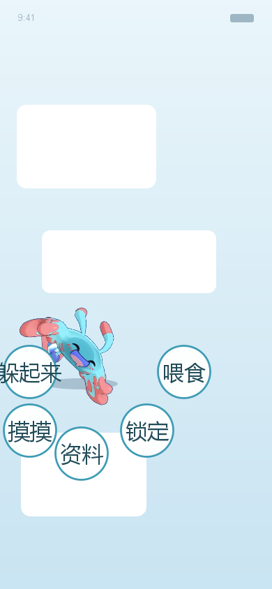

# 彩蝶鲨桌宠 · Caidiesha Desktop Pet

给「洛克王国：世界」里的**彩蝶鲨**做的一个 Android 桌宠：装好、给一个悬浮窗权限，
它就会像游戏设定里那样「借气流」在屏幕上飘来飘去；点一下有 Q 弹 + 水花 + 啵声，
连点两下原地转圈，长按在它身下浮出一圈带字的小圆点按钮（喂食 / 摸摸 / 躲起来 / 资料 / 锁定）。

- **不需要 Gradle、不需要联网**：纯 Android SDK 命令行工具链手工构建
- **APK 只有 478 KB**，零第三方依赖（没有 androidx、没有任何库）
- **飘动物理是一个零 Android 依赖的类**，因此能在电脑上单独跑长时间验证



---

## 特性

| 功能 | 说明 |
| --- | --- |
| 飘动 | 每 3.5~7 秒换一个「气流落点」，朝落点施加转向加速度（转向是圆滑的），越接近越收力；纵向叠一层浮力起伏，飘得越快摆幅越大 |
| 转身 | 水平速度反向时精灵左右镜像 |
| 点击 | Q 弹一下（弹簧挤压）+ 水花粒子 + 合成的「啵」声 |
| 双击 | 原地转圈（转速指数衰减） |
| 拖动 | 精确跟手（绝对定位，不受窗口移动影响），拖动时甩水滴拖尾，松手带惯性 |
| 长按 | 身下浮出 5 个直径 60dp 的带字圆点按钮，一道弧（躲起来在正中） |
| 锁定 | 原地定住、角度归零，左上角出现一个小锁标记；再点「解锁」回到屏幕中间重新飘 |
| 息屏 | 屏幕熄灭时停止动画（不费电），点亮自动继续 |
| 开机自启 | 上次是开着的话，重启后自己回来 |
| 触摸穿透 | 悬浮窗只覆盖彩蝶鲨周围那一小块，其余屏幕完全穿透，不影响正常用手机 |

---

## 快速开始

### 1. 直接用 APK

下载 `docs/caidiesha-pet-v2.9.apk`（或 Releases 里的），传到手机上安装。
首次打开需要给「显示在其他应用上层」权限，然后点「放彩蝶鲨出去飘」。

### 2. 自己编译

需要 **JDK 17** 和 **Android SDK**（build-tools + 任一 platform）。路径会自动探测，
也可以用参数指定：

```powershell
# 自动探测（默认找 D:\android-sdk 和 C:\Program Files\Microsoft\jdk-17*）
powershell -ExecutionPolicy Bypass -File build.ps1

# 手动指定
powershell -ExecutionPolicy Bypass -File build.ps1 -SdkDir "C:\Android\Sdk" -JdkHome "C:\Java\jdk-17"

# 跳过从参考图重新生成精灵（只想改代码时更快）
powershell -ExecutionPolicy Bypass -File build.ps1 -SkipAssets
```

构建流程（全部是 SDK 自带工具）：

```
aapt2 compile → aapt2 link → javac → d8 → 打包 → zipalign → apksigner → 静态检查
```

产物在 `app/build/caidiesha-pet.apk`（自签名，可直接安装）。

---

## 项目结构

```
build.ps1                     纯 SDK 构建脚本（自动探测环境，末尾会跑 5 个静态检查）
app/
  src/main/
    AndroidManifest.xml
    java/com/dsh/caidiesha/
      Physics.java            飘动物理 —— 零 Android 依赖，可单独编译运行
      PetView.java            触摸互动、粒子、圆点菜单、渲染（全部 Canvas 手绘）
      FloatingPetService.java 前台服务 + 跟随式悬浮窗 + 权限自愈
      CaidieshaDex.java       官方图鉴数据
      Sfx.java                AudioTrack 实时合成音效（无音频文件）
      MainActivity.java       主界面
      PetApp.java             全局崩溃日志
      BootReceiver.java       开机自启
    res/                      精灵图 / 图标 / 布局 / 配色
tools/                        静态检查与素材工具（见下）
work/
  ref_full.jpg                参考截图（用户自备）
  ref_face.jpg
docs/                         预览图与已构建的 APK
```

---

## 静态检查工具（这个项目最值钱的部分）

这个项目的动画和窗口逻辑**没法靠肉眼看出来对不对**，所以我把关键逻辑都变成了
「能在电脑上跑、有断言、会失败」的检查工具。它们**真的抓到过 bug**，不是摆设：

| 工具 | 检查什么 | 抓到的真实 bug |
| --- | --- | --- |
| `RecursionCheck` | 扫源码找「无参方法里无参调用自己」 | `topLimit()` 写成了 `return topLimit();` → 无限递归 → `StackOverflowError`，**桌宠从第一版起就没显示过** |
| `PhysicsCheck` | 3 种屏幕 × 216,000 帧长时间仿真 | ① 漫游范围只有屏宽 29%（原地打转）② 边界夹取用了上一帧的起伏量 → 起伏时探头出屏 |
| `DragCheck` | 模拟「窗口更新滞后于手指」 | 拖动用增量计算，窗口一动坐标系就变 → 误差累积，精灵窜出去（旧写法最大偏差 293px，新写法 0.000px） |
| `MenuCheck` | 遍历精灵所有位置 × 起伏相位 | 菜单面板会被窗口裁掉（只显示上半部分）；按钮与身体重叠 |
| `LockFlowCheck` | **直接读 PetView 源码做断言**，覆盖整条锁定/解锁/长按链路 | 长按回调里的 `state == DRAG` 把锁定时的长按挡掉了 |
| `SpriteOverlap` | 用精灵的**真实不透明像素**（不是外接矩形）判断按钮有没有压住身体 | 菜单几何的判据本身不严谨，会误报 |
| `ColorAudit` / `StrictAudit` | 逐像素核对抠图是否改过颜色 | 抠图容差过大 + alpha 羽化，改掉了官方配色 |
| `StrictCut` / `ExportStrict` / `IconStrict` | 严格模式抠图与导出（只判背景，RGB 一个比特都不动） | — |
| `PhysPreview` | 用 App 里那份 `Physics.java` 在电脑上渲染出 GIF 预览 | 预览与 App 尺寸基准混用，精灵被画得比屏幕还大 |
| `SamplePalette` | 从原图统计角色真实用色 | 我按色相平均算出来的「嘴紫」在原图里根本不存在 |

单独跑某一个：

```powershell
# 例：跑物理长时间验证
javac -encoding UTF-8 -d work/classes app/src/main/java/com/dsh/caidiesha/Physics.java tools/PhysicsCheck.java
java -cp work/classes PhysicsCheck app/src/main/java/com/dsh/caidiesha/Physics.java
```

---

## 验证证据

| 检查 | 结果 |
| --- | --- |
| 精灵配色 | APK 内 58,021 个不透明像素与参考图 **100% 一致**，偏色 0，羽化 0 |
| 物理仿真 | 3 种屏幕 × 216,000 帧（含掉帧/卡顿注入）**24 项全过**，0 次越界 |
| 拖动 | 窗口滞后 1~16 帧下偏差 **0.000 px** |
| 圆点菜单 | **5625 个位置** 全部完整可见、互不重叠、不压身体 |
| 锁定链路 | **19 项断言**全过（改坏了会失败） |

---

## 已知取舍

- **没有模拟器实测**：开发机上没有可用的 Android 模拟器，所以悬浮窗的手势行为
  是靠「静态断言 + 屏上诊断 + 真机反馈」三条腿收敛的，不是自动化测试。
- **单弧按钮尺寸不能更小**：精灵占屏宽 44%，5 个圆点要塞进剩下的 56%，
  数学上只有 60dp + 155° 弧这一组解（试过 38/44/46dp 全部重叠）。想更小就得换布局。
- **菜单按钮是我唯一自编的文字**（喂食/摸摸/躲起来/资料/锁定），
  其余文字都是官方图鉴数据或纯功能标签。

---

## 许可

- **代码**（Java 源码、构建脚本、检查工具、文档）：[MIT](LICENSE)
- **美术与游戏数据**：版权归腾讯 / 洛克王国项目组，本仓库仅作个人学习自用，
  详见 [NOTICE.md](NOTICE.md)。**请勿商用或二次分发素材。**

本项目与腾讯、洛克王国官方无任何隶属关系。
